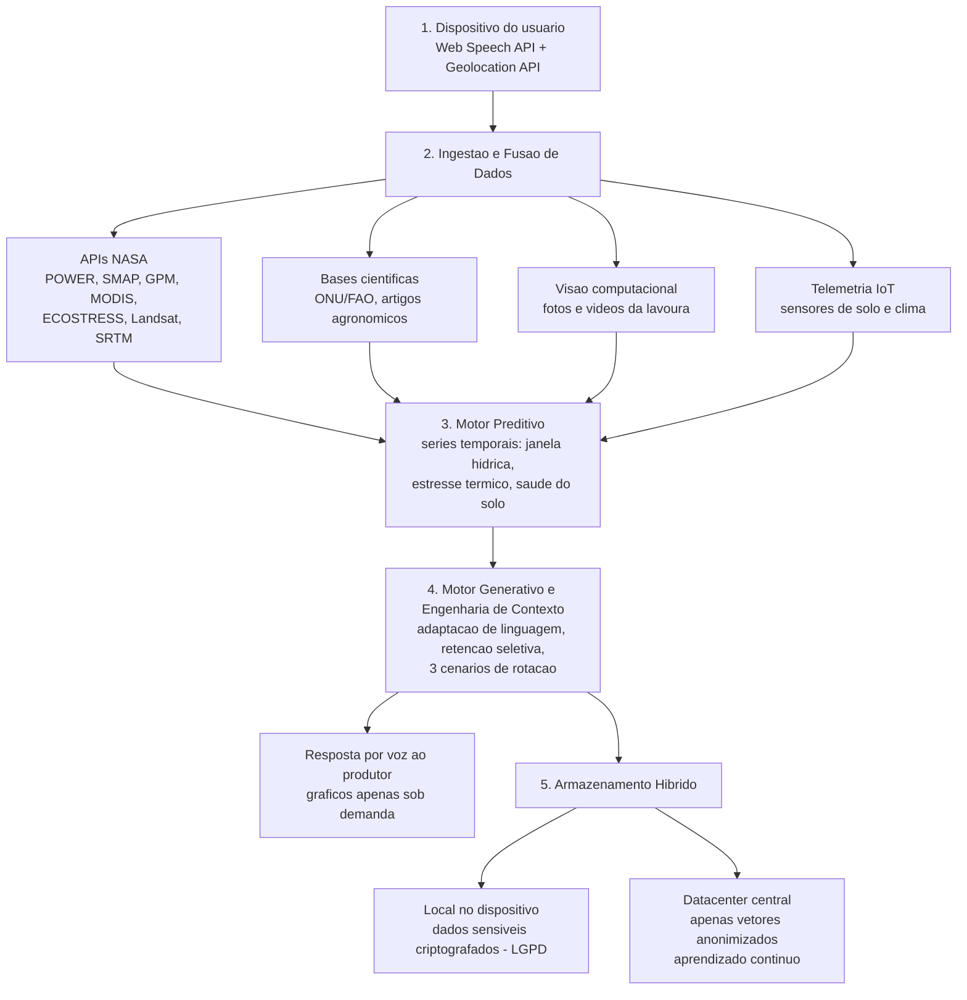

# S.O.L. (Satellite-Oriented LLM / LLM Orientado por Satélite)

**Assistente de Inteligência Artificial Preditiva e Generativa Guiado por Voz para Decisão Agrícola e Adaptação Climática**

| Campo | Informação |
|---|---|
| Significado da sigla | S.O.L. = Satellite-Oriented LLM (LLM Orientado por Satélite) |
| Organização | B.I.G. Tech (Boundless Intelligence & Global Tech) |
| Instituição | Departamento de Ciência da Computação, Universidade Estadual do Sudoeste da Bahia (UESB), Vitória da Conquista, Bahia, Brasil |
| Evento | NASA Space Apps Challenge 2026 |
| Desafio | Field Shift: Adapting Farms with NASA Data |
| Status | Protótipo funcional (hackathon) |

---

## Sumário

1. [Visão Geral e Problema](#1-visão-geral-e-problema)
2. [Status do Protótipo](#2-status-do-protótipo)
3. [Arquitetura do Sistema e Pipeline de Dados](#3-arquitetura-do-sistema-e-pipeline-de-dados)
4. [Fontes de Dados da NASA](#4-fontes-de-dados-da-nasa)
5. [Funcionalidades Principais](#5-funcionalidades-principais)
6. [Tecnologias e Execução Local](#6-tecnologias-e-execução-local)
7. [Impacto Social e Ambiental (ODS)](#7-impacto-social-e-ambiental-ods-da-onu)
8. [Roadmap de Evolução](#8-roadmap-de-evolução)
9. [Equipe e Licença](#9-equipe-e-licença)

---

## 1. Visão Geral e Problema

### Problema

Produtores rurais, em especial agricultores familiares, enfrentam simultaneamente:

- **Instabilidade climática:** chuvas irregulares, ondas de calor e eventos extremos que invalidam o calendário agrícola tradicional.
- **Escassez hídrica:** redução da disponibilidade de água e dificuldade de planejar irrigação e escolha de culturas.
- **Esgotamento do solo:** perda de matéria orgânica, erosão e queda de produtividade causadas por monocultura e solo exposto.
- **Barreira de alfabetização digital:** as ferramentas de agricultura de precisão existentes exigem leitura, cadastro e familiaridade com interfaces complexas, o que exclui justamente quem mais depende da terra para sobreviver.

### Solução

O S.O.L. (Satellite-Oriented LLM) é um modelo de linguagem orientado por dados de satélite. Ele atua como ponte entre a telemetria orbital da NASA e o campo, por meio de uma interface **100% guiada por voz (Voice-First UI)**.

O sistema:

1. coleta a geolocalização do produtor e a extensão da área produtiva;
2. processa dados satelitais em modelos preditivos;
3. utiliza um modelo generativo de linguagem, ancorado nesses dados, para orientar o produtor verbalmente, em linguagem simples;
4. exibe gráficos comparativos de produção, água, solo e custo **apenas sob demanda**, por comando de voz.

O objetivo do projeto é apoiar a decisão do produtor, e não substituí-la nem substituir o técnico agrícola local.

---

## 2. Status do Protótipo

Este repositório contém um **protótipo de interface e de fluxo conversacional**. É importante distinguir o que já funciona do que está planejado:

| Componente | Estado no protótipo |
|---|---|
| Diálogo por voz (reconhecimento e síntese em pt-BR) | Funcional |
| Geolocalização com fallback automático | Funcional |
| Extração de área, cultura e dificuldade a partir da fala | Funcional (regras e expressões regulares) |
| Alteração da área por comando de voz com recálculo | Funcional |
| Gráficos sob demanda por voz | Funcional |
| Dados NASA (POWER, SMAP, GPM, MODIS, ECOSTRESS, Landsat, SRTM) | **Simulados** de forma determinística por coordenada e área, sem chamada às APIs reais |
| Modelo preditivo e simulador de rotação | Heurístico, com valores ilustrativos |
| Visão computacional, RAG científico, IoT, backend | Planejados (ver [Roadmap](#8-roadmap-de-evolução)) |

Os valores exibidos pelo protótipo **não devem ser usados para decisões reais de safra**. A substituição de cada bloco simulado por ingestão real está descrita na seção 3 e no roadmap.

---

## 3. Arquitetura do Sistema e Pipeline de Dados

### 3.1 Fluxo ponta a ponta



### 3.2 Etapas

| Etapa | Descrição |
|---|---|
| 1. Captura | Voz via SpeechRecognition (pt-BR) e coordenadas via Geolocation API. Sem GPS, o sistema usa uma região aproximada e informa o produtor. |
| 2. Ingestão e fusão | As camadas são recortadas pela área informada (raio derivado da extensão ou polígono) e harmonizadas em uma grade comum. Fontes: APIs da NASA, bases científicas ONU/FAO, imagens e vídeos da lavoura e telemetria IoT. |
| 3. Motor preditivo | Séries temporais para janela hídrica, estresse térmico e saúde do solo. Produz índices de risco de falta de água e de degradação do solo, além de estimativa de produção por estratégia. |
| 4. Motor generativo | Converte as saídas numéricas em texto falado ajustado ao perfil do usuário. Aplica retenção seletiva de contexto (guarda apenas fatos agronômicos relevantes) e gera três cenários: **manejo atual**, **rotação regenerativa** e **baixo consumo hídrico**. O texto verbaliza apenas números presentes nas saídas dos modelos. |
| 5. Armazenamento híbrido | Dados sensíveis (histórico bruto, coordenadas exatas, informações de produção) permanecem criptografados no dispositivo, em conformidade com a LGPD. Somente vetores de aprendizado anonimizados e dados agregados seguem ao datacenter central para aprendizado contínuo. |

### 3.3 Estrutura do modelo de decisão (protótipo)

```
entrada:  area (ha), cultura, dificuldade principal, coordenadas (lat, lon)
pipeline: pipe()    -> indicadores NASA simulados (chuva, umidade, NDVI, calor, solo exposto, declividade)
          build()   -> indices ws (risco hidrico) e sd (degradacao do solo)
                       3 estrategias: atual, rotacao, adubo verde
                       pontuacao ponderada pela dificuldade informada
saida:    texto falado (diagnostico + recomendacao + producao estimada)
          visualizacao opcional (barras de Agua, Terra, Custo e Producao)
```

---

## 4. Fontes de Dados da NASA

| Produto | Variável utilizada | Aplicação no motor do S.O.L. |
|---|---|---|
| NASA POWER | Insolação, temperatura e séries históricas | Cálculo da janela de plantio e do balanço hídrico |
| SMAP (Soil Moisture Active Passive) | Umidade do solo na camada superficial e na zona de raiz | Indicador de estresse hídrico e apoio à decisão de irrigação |
| GPM (Global Precipitation Measurement) | Regime de precipitação e anomalias de chuva | Chuva recente contra a normal climatológica e eventos extremos |
| MODIS | NDVI e vigor foliar | Monitoramento do ciclo e da saúde da vegetação |
| ECOSTRESS | Temperatura da superfície terrestre e evapotranspiração | Estresse hídrico e térmico em alta resolução |
| Landsat | Detecção de solo exposto e histórico de uso da terra | Identificação de períodos de campo descoberto e análise por talhão |
| SRTM (Shuttle Radar Topography Mission) | Altimetria e declividade | Modelagem de risco de erosão e drenagem |

**Harmonização:** as camadas possuem resoluções espaciais e temporais distintas (de dezenas de metros a dezenas de quilômetros). O pipeline planejado reamostra todas para uma grade comum, aplica refinamento espacial da umidade do solo com NDVI, temperatura e relevo e calcula estatísticas zonais por área informada.

---

## 5. Funcionalidades Principais

- **Interface Voice-First adaptativa:** conduz toda a experiência por voz, atendendo desde o agricultor familiar sem escolaridade formal até gestores de grandes propriedades comerciais, ajustando vocabulário e profundidade técnica.
- **Dimensionamento dinâmico da área:** o produtor informa ou altera a extensão por voz (hectares, tarefas, alqueires ou metros quadrados), e as previsões são recalculadas imediatamente. Exemplo de comando: "mudar área para dez hectares".
- **Simulação comparativa de três estratégias:** manejo atual, rotação regenerativa e baixo consumo hídrico, com indicadores de Água, Solo e Custo e estimativa de produção para a área informada.
- **Renderização condicional de gráficos:** a tela permanece limpa (esfera solar e botão de microfone). Os gráficos aparecem somente com comandos como "mostrar gráficos" e são ocultados com "esconder gráficos".
- **Validação local recomendada:** toda recomendação é acompanhada do aviso explícito para confirmar com o técnico agrícola ou a extensão rural local.

### Comandos de voz do protótipo

| Comando (exemplos) | Efeito |
|---|---|
| "dois hectares", "dez tarefas", "meio hectare" | Define a área da lavoura |
| "milho", "feijão", "mandioca", "hortaliças" | Define a cultura atual |
| "falta de chuva", "praga", "terra fraca", "preço" | Define a principal dificuldade |
| "mudar área para 10 hectares", "alterar tamanho da terra" | Altera a área e recalcula |
| "mostrar gráficos", "ver plano", "produção" | Exibe os gráficos |
| "esconder gráficos", "fechar tela" | Oculta os gráficos |
| "outro caminho" | Alterna entre as três estratégias |
| "repetir", "explicar", "detalhes" | Repete o diagnóstico |
| "recomeçar" | Reinicia a conversa |
| "ajuda" | Descreve as funcionalidades |

---

## 6. Tecnologias e Execução Local

### 6.1 Stack do protótipo

| Camada | Tecnologia |
|---|---|
| Marcação e estilo | HTML5, CSS3 com variáveis de tema adaptativo (modo claro e escuro) |
| Lógica | JavaScript Vanilla ES6+ |
| Voz | Web Speech API: `SpeechRecognition` e `SpeechSynthesis` (pt-BR) |
| Localização | Geolocation API |
| Mídia | FileReader API para captura e leitura de fotos e vídeos |

### 6.2 Stack de escalabilidade (planejada)

| Camada | Tecnologia |
|---|---|
| Backend | Python, FastAPI |
| Modelos | Modelos preditivos de séries temporais e produtividade, simulador de rotação (balanço hídrico e de nitrogênio) |
| Dados geoespaciais | Catálogo STAC, formatos COG e Zarr |
| Arquitetura | Híbrida Edge/Datacenter, com aprendizado federado e privacidade diferencial |
| Voz em escala | Streaming ASR, LLM e TTS, microsserviços e filas assíncronas |

### 6.3 Requisitos

- Navegador compatível: **Google Chrome**, **Microsoft Edge** ou **Safari**. O Firefox não implementa `SpeechRecognition`.
- Permissão de **microfone** e de **localização** concedidas ao navegador.
- Conexão com a internet: o reconhecimento de voz dos navegadores baseados em Chromium utiliza serviço remoto.
- Execução por `http://localhost` ou HTTPS. Evite abrir o arquivo diretamente por `file://`, pois alguns navegadores bloqueiam microfone e geolocalização nesse modo.

### 6.4 Clonar e executar

```bash
# 1. Clonar o repositorio (substitua pela URL real)
git clone https://github.com/<organizacao>/sol.git
cd sol

# 2. Servir os arquivos localmente (opcao A: Python)
python3 -m http.server 8080

# opcao B: Node.js
npx serve .

# 3. Abrir no navegador
# http://localhost:8080
```

Passos de uso:

1. Abra a página no Chrome, Edge ou Safari.
2. Toque no botão de microfone para iniciar. A primeira interação do usuário é exigida pelos navegadores para liberar a fala.
3. Conceda as permissões de microfone e de localização.
4. Responda por voz às perguntas sobre área, cultura e dificuldade principal.
5. Peça "mostrar gráficos" para visualizar a comparação das estratégias.

### 6.5 Estrutura sugerida do repositório

```
sol/
|-- index.html        # prototipo (interface, dialogo por voz, motor de decisao simulado)
|-- README.md
|-- docs/
|   |-- architecture.md
|   `-- scalability-plan.md
`-- LICENSE
```

---

## 7. Impacto Social e Ambiental (ODS da ONU)

| ODS | Contribuição direta do projeto |
|---|---|
| ODS 2: Fome Zero e Agricultura Sustentável | Apoia a decisão de plantio e rotação de culturas para aumentar a produtividade e a segurança alimentar de pequenos produtores, com acesso por voz independente de escolaridade. |
| ODS 6: Água Potável e Saneamento | Orienta o uso eficiente da água com base em umidade do solo, precipitação e estresse hídrico, priorizando estratégias de menor consumo. |
| ODS 13: Ação Contra a Mudança Global do Clima | Auxilia a adaptação a eventos extremos e à variabilidade climática, incentivando práticas de cobertura do solo e redução de emissões associadas ao manejo. |
| ODS 15: Vida Terrestre | Reduz solo exposto e erosão, promove rotação e adubação verde e contribui para a recuperação da matéria orgânica e da biodiversidade do solo. |

---

## 8. Roadmap de Evolução

| Fase | Prazo | Escopo | Critérios de sucesso |
|---|---|---|---|
| Protótipo (Hackathon) | Concluído | Interface Voice-First, diálogo guiado por voz, geolocalização, três estratégias simuladas, gráficos sob demanda | Demonstração funcional ponta a ponta |
| MVP | 3 a 6 meses | Integração em produção com NASA POWER, GPM e SMAP; recorte por área; RAG com base FAO e Embrapa; backend FastAPI; canais USSD e SMS; cofre local criptografado | Pipeline real operando; compreensão de voz acima de 90% em sotaques regionais |
| Piloto | 6 a 12 meses | Operação junto à extensão rural e a cooperativas; diagnóstico visual de pragas; importação de planilhas e laudos; validação agronômica | Piloto com 50 a 200 produtores; recomendações aplicadas em campo; métricas de produtividade e de uso de água |
| Escala | 12 a 24 meses | Parcerias institucionais; integração IoT (LoRaWAN e MQTT); aprendizado federado; painel corporativo e API para ERPs | Milhares de usuários simultâneos; retreino por safra validado; auditoria de privacidade |

---

## 9. Equipe e Licença

**B.I.G. Tech (Boundless Intelligence & Global Tech)**
Departamento de Ciência da Computação
Universidade Estadual do Sudoeste da Bahia (UESB)
Vitória da Conquista, Bahia, Brasil

Projeto desenvolvido para o NASA Space Apps Challenge 2026, desafio Field Shift: Adapting Farms with NASA Data.

### Licença

Licença a ser definida pela equipe (sugestão: MIT). Inclua o arquivo `LICENSE` na raiz do repositório antes da publicação.

### Aviso

O S.O.L. é uma ferramenta de apoio à decisão. As recomendações não substituem o julgamento do produtor nem a orientação de técnicos agrícolas e serviços de extensão rural. Os dados exibidos no protótipo são simulados e não devem ser utilizados para decisões reais de safra.
