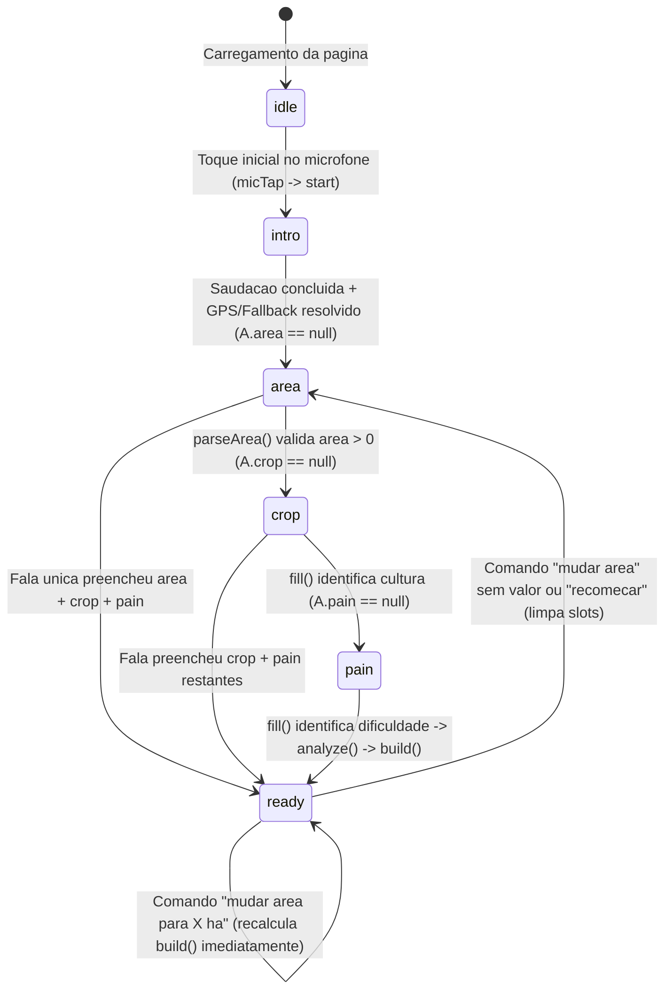

# Arquitetura Interna do Protótipo — S.O.L. (`index.html`)

**Organização:** B.I.G. Tech (Boundless Intelligence & Global Tech)  
**Instituição:** Departamento de Ciência da Computação, Universidade Estadual do Sudoeste da Bahia (UESB)  
**Arquivo de Referência:** [`index.html`](../index.html)  

---

## Sumário

1. [Visão Geral da Aplicação Single-File](#1-visão-geral-da-aplicação-single-file)
2. [Máquina de Estados de Voz e Ciclo Conversacional](#2-máquina-de-estados-de-voz-e-ciclo-conversacional)
3. [Parser de Linguagem Natural em Português (`norm`, `parseArea`, `fill`)](#3-parser-de-linguagem-natural-em-português-norm-parsearea-fill)
4. [Pipeline Determinístico de Simulação Orbital NASA (`pipe`)](#4-pipeline-determinístico-de-simulação-orbital-nasa-pipe)
5. [Modelo Preditivo, Ponderação Multicritério e Motor Generativo (`build`)](#5-modelo-preditivo-ponderação-multicritério-e-motor-generativo-build)
6. [Renderização Visual Sob Demanda e Interface Solar (`viz`, `renderViz`)](#6-renderização-visual-sob-demanda-e-interface-solar-viz-renderviz)

---

## 1. Visão Geral da Aplicação Single-File

O protótipo do S.O.L. foi projetado em um único arquivo autocontido (`index.html`), sem dependências externas, bibliotecas de terceiros ou etapas de compilação. Essa decisão arquitetural garante carregamento instantâneo em conexões rurais de baixa largura de banda, facilidade de auditoria e execução direta em qualquer navegador moderno compatível com a Web Speech API.

### 1.1 Estrutura de Camadas no `index.html`

| Camada | Componentes Principais | Responsabilidade |
|---|---|---|
| **Apresentação e Tema (CSS3)** | Variáveis CSS (`--bg`, `--acc`, `--pri`), `.orb`, `.mic`, `.hero`, `.bar` | Suporte adaptativo a modo escuro/claro, animações da esfera solar por estado acústico (`idle`, `talk`, `listen`) e barras comparativas |
| **Estado Global de Sessão** | `A`, `L`, `FB`, `plan`, `sel`, `state`, `started`, `rec`, `tk`, `nsp`, `locP` | Manutenção dos slots agronômicos coletados, coordenadas geográficas, controle de concorrência de fala e plano calculado |
| **Camada de Voz (I/O)** | `say()`, `seq()`, `listen()`, `again()`, `micTap()` | Orquestração da síntese (`SpeechSynthesis`) e do reconhecimento de voz (`SpeechRecognition`) em `pt-BR` sem sobreposição de áudio |
| **Compreensão de Linguagem Natural (NLU)** | `norm()`, `parseArea()`, `fill()`, `handle()`, `miss()` | Normalização fonética/ortográfica, conversão de medidas agrárias brasileiras e extração de intenções e entidades |
| **Simulador Orbital NASA** | `pipe()` | Geração determinística de 11 indicadores agrometeorológicos e topográficos baseados nas 7 missões da NASA a partir de latitude, longitude, área e cultura |
| **Motor de Decisão e Geração** | `build()`, `analyze()`, `fmtA()`, `fmtP()`, `lvl()` | Cálculo de risco hídrico (`ws`) e de solo (`sd`), simulação de 3 estratégias de manejo, pontuação ponderada pela dor do produtor e geração das frases faladas |
| **Visualização Condicional** | `viz()`, `renderViz()` | Exibição e ocultação dinâmica dos gráficos comparativos no DOM apenas quando solicitado por voz |

### 1.2 Variáveis Globais de Estado

```javascript
var A = { area: null, crop: null, pain: null }, // Slots do perfil produtivo
    L = null,                                   // Coordenadas ativas {lat, lon}
    plan = null,                                // Objeto retornado por build()
    sel = 0,                                    // Indice da estrategia em foco (0, 1 ou 2)
    state = 'idle',                             // Estado atual da maquina de dialogo
    started = false,                            // Indica se o primeiro toque ja ocorreu
    rec = null,                                 // Instancia ativa de SpeechRecognition
    tk = 0,                                     // Token monotônico anti-condicao de corrida
    nsp = 0,                                    // Contador de tentativas sem fala (no-speech)
    locP = null;                                // Promise da captura assincrona de GPS
var FB = { lat: -14.9, lon: -40.8 };            // Fallback geografico (Nordeste / Sudoeste da Bahia)
```

---

## 2. Máquina de Estados de Voz e Ciclo Conversacional

O fluxo de diálogo do S.O.L. é governado pela variável `state`, que assume seis estados bem definidos: `idle`, `intro`, `area`, `crop`, `pain` e `ready`. Paralelamente, o atributo visual `data-m` da esfera solar (`#orb`) reflete o estado acústico imediato (`idle`, `talk` ou `listen`).

### 2.1 Diagrama de Transição de Estados



### 2.2 Detalhamento dos Estados (`idle`, `intro`, `area`, `crop`, `pain`, `ready`)

1. **`idle` (Repouso Inicial):**
   - Estado inicial ao abrir a aplicação.
   - Os navegadores modernos exigem uma interação explícita do usuário (User Gesture) antes de liberar o áudio sintetizado (`SpeechSynthesis`) e a captura de microfone.
   - O rodapé exibe `"Toque no microfone para falar com o S.O.L."`. Ao clicar no botão `#mic`, `micTap()` verifica `!started` e invoca `start()`.

2. **`intro` (Apresentação e Captura Geográfica Paralela):**
   - Ativado por `start()`. Define `started = true` e `state = 'intro'`.
   - Dispara imediatamente, em paralelo à fala inicial, uma `Promise` (`locP`) que consulta `navigator.geolocation.getCurrentPosition` com `timeout: 8000` ms e `maximumAge: 600000` ms (10 minutos).
   - Enquanto o GPS é buscado em segundo plano, `seq()` pronuncia as mensagens de boas-vindas e instruções de uso.
   - Ao término da saudação, `locP.then(...)` resolve `L` com a coordenada real do dispositivo ou aplica o fallback `FB = {lat: -14.9, lon: -40.8}`, informando verbalmente o usuário e invocando `next()`.

3. **`area` (Coleta da Extensão da Lavoura):**
   - Ativado em `next()` quando `A.area == null`.
   - O assistente pergunta: *"Qual o tamanho da sua lavoura? Pode falar em hectares, tarefas ou metros. Por exemplo: dois hectares."*
   - Em caso de falha de compreensão, `miss()` orienta: *"Não entendi. Diga, por exemplo: dois hectares, ou dez tarefas."*

4. **`crop` (Coleta da Cultura Agrícola Atual):**
   - Ativado em `next()` quando `A.area != null` e `!A.crop`.
   - O assistente pergunta: *"E o que você planta hoje? Milho, feijão, mandioca ou hortaliças?"*
   - Se a resposta não contiver uma cultura mapeada, `miss()` orienta com as quatro opções válidas.

5. **`pain` (Coleta da Dificuldade Principal de Manejo):**
   - Ativado em `next()` quando `A.area != null`, `A.crop != null` e `!A.pain`.
   - O assistente pergunta: *"Qual é a sua maior dificuldade? Falta de chuva, praga, terra fraca ou preço pra vender?"*

6. **`ready` (Diagnóstico Concluído e Diálogo Aberto de Exploração):**
   - Quando os três atributos de `A` estão preenchidos, `next()` chama `analyze()`, que executa `build()`, armazena o resultado em `plan`, seleciona a melhor estratégia (`sel = plan.best`), define `state = 'ready'` e narra os 6 blocos de diagnóstico (`plan.chunks`).
   - Se o usuário já possuía um plano anterior (`had == true`, por exemplo após alterar a área), o S.O.L. pronuncia uma versão concisa contendo apenas a confirmação da nova área, a recomendação principal, a nova estimativa de produção e o lembrete dos gráficos (`[pre, c[2], c[3], c[5]]`).
   - Em `ready`, o usuário pode acionar comandos de controle visual, alternar entre as 3 estratégias (`"outro caminho"`), repetir a explicação (`"repetir"`), alterar o tamanho da área (`"mudar área para dez hectares"`), trocar a dificuldade principal ou reiniciar (`"recomeçar"`).

### 2.3 Controle de Turno e Prevenção de Eco Acústico (`tk`, `say`, `listen`)

Para impedir que o microfone capture a própria voz sintetizada do S.O.L. ou que callbacks atrasados corrompam o estado:
- O contador global `tk` é incrementado a cada chamada de `say()` ou `listen()`.
- Antes de falar (`say`), qualquer instância ativa de `SpeechRecognition` (`rec`) é abortada (`rec.abort()`).
- Antes de ouvir (`listen`), qualquer síntese em andamento é cancelada (`ss.cancel()`).
- Callbacks `onend` e `onerror` verificam `if (my != tk) return;` ou `if (rec != r) return;`, descartando eventos obsoletos.
- Caso ocorra erro `no-speech` (silêncio temporário do produtor), o sistema incrementa `nsp` e reabre a escuta automaticamente por até 3 tentativas consecutivas com intervalo de 300 ms antes de repousar em modo `idle`.

---

## 3. Parser de Linguagem Natural em Português (`norm`, `parseArea`, `fill`)

O protótipo implementa um motor determinístico de compreensão de linguagem natural (NLU) voltado para o português falado no meio rural brasileiro, capaz de preencher múltiplos slots em uma única frase ou individualmente.

### 3.1 Normalização Textual (`norm`)

```javascript
function norm(s) {
  return s.toLowerCase().normalize('NFD').replace(/[\u0300-\u036f]/g, '');
}
```

A função `norm(s)` converte a transcrição do `SpeechRecognition` para letras minúsculas, decompõe os caracteres acentuados pelo padrão Unicode `NFD` e remove os sinais diacríticos (`\u0300` a `\u036f`). Assim, `"Feijão"`, `"feijao"` e `"FEIJÃO"` convergem para `"feijao"`, simplificando todas as expressões regulares subsequentes.

### 3.2 Extração e Conversão de Unidades Agrárias (`parseArea`)

A função `parseArea(t)` interpreta números expressos em algarismos, números por extenso em português, frações usuais (`"meio"`, `"e meia"`) e quatro unidades de medida de terra, convertendo sempre o resultado final para **hectares (`ha`)**.

#### Dicionário Numérico (`W`)
```javascript
var W = {
  um: 1, uma: 1, dois: 2, duas: 2, tres: 3, quatro: 4, cinco: 5,
  seis: 6, sete: 7, oito: 8, nove: 9, dez: 10, onze: 11, doze: 12,
  quinze: 15, vinte: 20, trinta: 30, quarenta: 40, cinquenta: 50,
  sessenta: 60, cem: 100, cento: 100, duzentos: 200, quinhentos: 500, mil: 1000
};
```

#### Etapas de Resolução em `parseArea(t)`
1. **Detecção de Algarismos:** Tenta capturar padrões numéricos diretos via `/(\d+(?:[.,]\d+)?)/` (ex.: `"2"`, `"2,5"`, `"10.5"`), convertendo vírgula decimal em ponto.
2. **Soma de Números por Extenso:** Caso não haja algarismos, percorre os tokens da frase (`t.split(/\W+/)`) acumulando valores presentes em `W` (ignorando a conjunção `"e"`, como em `"vinte e cinco"` -> `20 + 5 = 25`, e tratando `"mil"` como multiplicador `(s || 1) * 1000`) até encontrar o nome da unidade de medida.
3. **Tratamento de Frações ("meio" / "meia"):**
   - Se nenhum número foi encontrado, mas a frase contém `\bmeio\b|\bmeia\b` (ex.: `"meio hectare"`, `"meia tarefa"`), define `v = 0.5`.
   - Se já existe um valor principal e a frase contém `/ e (meio|meia)\b/` (ex.: `"dois hectares e meio"`, `"tres tarefas e meia"`), soma `+0.5` a `v`.
4. **Fator de Conversão Agrária (`k`):**
   Identifica a unidade mencionada por `/hectare|\bha\b|tarefa|metro|m2|alqueire/` (assumindo `hectare` como padrão quando omitida no estado `area`) e aplica o fator de conversão para hectares:

| Unidade Falada | Expressão Regular | Equivalência em $\text{m}^2$ | Fator Multiplicador (`k`) em Hectares |
|---|---|---|---|
| Hectare (padrão) | `/hectare\|\bha\b/` | $10.000\text{ m}^2$ | `1.0` |
| Tarefa (padrão baiano) | `/tarefa/` | $4.356\text{ m}^2$ | `0.4356` |
| Metro quadrado | `/metro\|m2/` | $1\text{ m}^2$ | `0.0001` (`1e-4`) |
| Alqueire (padrão paulista) | `/alqueire/` | $24.200\text{ m}^2$ | `2.42` |

### 3.3 Preenchimento Multi-Slot (`fill`) e Roteamento de Intenções (`handle`)

A função `fill(t)` analisa o texto normalizado e retorna um vetor `g` com os nomes dos slots preenchidos naquele turno (`'area'`, `'crop'`, `'pain'`):

1. **Extração de Área (`A.area`):** Executada se `state == 'area'` ou se o usuário mencionar explicitamente qualquer unidade de área em qualquer momento da conversa (`/hectare|\bha\b|tarefa|metro|m2|alqueire/`). Aceita valores no intervalo `0 < v < 100000` ha.
2. **Extração de Cultura (`A.crop`):**
   - `/feij/` -> `'Feijão'`
   - `/milho/` -> `'Milho'`
   - `/mandioca|macaxeira|aipim/` -> `'Mandioca'` (reconhece os sinônimos regionais brasileiros)
   - `/horta|verdura|legume/` -> `'Hortaliças'`
3. **Extração de Dificuldade (`A.pain`):** Executada quando `state == 'pain'` ou quando o usuário já está em `ready` e menciona `/dificuldade|problema|maior/`:
   - `/chuva|seca|agua|estiagem/` -> `'seca'`
   - `/praga|doenca|lagarta|bicho|inseto/` -> `'praga'`
   - `/fraca|solo|adubo|cansad/` -> `'solo'`
   - `/preco|venda|vender|mercado|dinheiro/` -> `'mercado'`

Antes de acionar `fill(t)`, a função `handle(t, raw)` intercepta comandos globais de navegação por voz:
- **Ocultar gráficos:** `/esconde|fech|ocult|sumir|limpa/` -> `viz(false)`
- **Mostrar gráficos:** `/grafic|mostr|ver (o )?plano|producao|barra|na tela/` -> `viz(true)` (ou solicita os dados da terra caso `plan` ainda seja `null`)
- **Reiniciar sessão:** `/recome|do zero|reinici/` -> reseta `A`, `plan` e oculta gráficos
- **Ajuda:** `/ajuda|o que voce faz|como funciona/` -> pronuncia a constante `FEAT`
- **Alterar área dinamicamente:** `/(mud|alter|troc|corrig)\w*.*(area|tamanho|terra|lavoura)/` -> se a frase já trouxer o novo número (ex.: `"mudar área para dez hectares"`), atualiza `A.area` e recalcula `analyze()` imediatamente; caso contrário, limpa `A.area = null` e pergunta a nova medida
- **Alternar estratégia recomendada:** `/outro|proxim/` -> avança ciclicamente `sel = (sel + 1) % 3`, atualiza os gráficos se visíveis e narra a estratégia selecionada
- **Repetir diagnóstico:** `/repet|de novo|ouvir|explic|detalh|diagnos/` -> executa `seq(plan.chunks, again)`

---

## 4. Pipeline Determinístico de Simulação Orbital NASA (`pipe`)

No protótipo, a função `pipe()` substitui as chamadas de rede às APIs da NASA por um gerador pseudoaleatório determinístico parametrizado pela localização geográfica (`L.lat`, `L.lon`), pela cultura (`A.crop`) e pela área (`A.area`). Isso garante que **a mesma coordenada e cultura produzam exatamente o mesmo diagnóstico climático e edáfico** em qualquer execução, permitindo testes reprodutíveis.

### 4.1 Semente Geográfica e Gerador Congruente Linear (LCG)

```javascript
var s = Math.round((L.lat + 90) * 100) * 7919 + Math.round((L.lon + 180) * 100) + A.crop.length * 13;
var r = function() {
  s = (s * 1664525 + 1013904223) >>> 0;
  return s / 4294967296;
};
var R = function(a, b) { return a + (b - a) * r(); };
```

- A semente inicial `s` combina a latitude deslocada (`L.lat + 90`) multiplicada pelo número primo `7919`, a longitude deslocada (`L.lon + 180`) em centésimos de grau (~1,1 km de resolução espacial) e o comprimento da string da cultura multiplicado por `13`.
- A função `r()` implementa um Gerador Congruente Linear (LCG de 32 bits sem sinal: $s_{k+1} = (1664525 \cdot s_k + 1013904223) \bmod 2^{32}$), retornando valores uniformes em $[0, 1)$.
- A função auxiliar `R(a, b)` escala a amostra para o intervalo físico $[a, b)$ de cada sensor orbital.

### 4.2 Geometria de Recorte e Variáveis Simuladas dos 7 Produtos da NASA

| Propriedade em `d` | Fórmula / Intervalo em `pipe()` | Missão NASA Representada | Significado Físico e Agronômico |
|---|---|---|---|
| `d.px` | `Math.round(A.area * 1e4 / 900)` | **Landsat / SRTM** | Quantidade equivalente de pixels de $30\text{ m} \times 30\text{ m}$ ($900\text{ m}^2$) contidos na lavoura |
| `d.rad` | `Math.round(Math.sqrt(A.area * 1e4 / Math.PI))` | Geometria Zonal | Raio equivalente em metros ($r = \sqrt{A/\pi}$) para recorte circular em torno do ponto GPS |
| `d.rain` | `Math.round(R(520, 1150))` | **NASA POWER** | Precipitação anual histórica média da localidade ($\text{mm/ano}$) |
| `d.tmax` | `+R(29, 35).toFixed(1)` | **NASA POWER** | Média das temperaturas máximas diárias ($\text{°C}$) |
| `d.smap` | `+R(0.12, 0.34).toFixed(2)` | **SMAP** | Umidade volumétrica do solo na zona radicular ($\text{m}^3/\text{m}^3$). Classificada em `build()` como `baixa` ($< 0,18$), `regular` ($< 0,26$) ou `boa` ($\ge 0,26$) |
| `d.ndvi` | `+R(0.35, 0.75).toFixed(2)` | **MODIS** | Índice de Vegetação por Diferença Normalizada (vigor da biomassa fotossintética) |
| `d.r30` | `Math.round(R(8, 95))` | **GPM (IMERG)** | Precipitação acumulada nos últimos 30 dias ($\text{mm}$) |
| `d.ext` | `Math.round(R(1, 8))` | **GPM (IMERG)** | Eventos de chuva extrema torrencial no ciclo anual |
| `d.dev` | `Math.round((d.r30 / (d.rain / 12) - 1) * 100)` | **GPM vs. POWER** | Anomalia percentual da chuva de 30 dias frente à média mensal histórica (`< -25%`: bem menos que o normal; `> +25%`: mais que o normal; caso contrário: perto do normal) |
| `d.hot` | `Math.round(R(15, 70))` | **ECOSTRESS** | Número de dias no ano com temperatura de superfície/dossel acima de $35\text{ °C}$ (estresse térmico) |
| `d.bare` | `Math.round(R(2, 6))` | **Landsat** | Meses por ano em que o solo permanece exposto (sem cobertura vegetal ou palhada) |
| `d.slope` | `Math.round(R(2, 14))` | **SRTM** | Declividade média do terreno em porcentagem ($\%$) |

### 4.3 Índices Compostos de Risco (`d.ws` e `d.sd`)

A partir das variáveis orbitais primárias, `pipe()` calcula dois índices sintéticos normalizados pela função `K(x, 95)` (que limita o valor inteiro ao intervalo $[5, 95]$):

1. **Índice de Estresse e Risco Hídrico (`d.ws` — Water Stress):**
   $$\text{ws} = \text{clamp}_{[5, 95]}\left(\text{round}\left(70 - \frac{\text{smap} - 0,12}{0,22}\times 40 - \frac{\text{rain} - 520}{630}\times 20 + 0,3 \times \text{hot}\right)\right)$$
   - Quanto menores a umidade do solo (`smap`) e a chuva anual (`rain`), e quanto maior o número de dias de calor extremo (`hot`), mais elevado é `d.ws`.

2. **Índice de Degradação e Erosão do Solo (`d.sd` — Soil Degradation):**
   $$\text{sd} = \text{clamp}_{[5, 95]}\left(\text{round}\left(8 \times \text{bare} + 2,2 \times \text{slope} + 2 \times \text{ext} + 40 \times (0,75 - \text{ndvi})\right)\right)$$
   - Penaliza períodos prolongados de solo descoberto (`bare`), maior declividade topográfica (`slope`), frequência de chuvas torrenciais (`ext`) e baixo vigor vegetativo (`ndvi`).

A função auxiliar `lvl(x)` traduz qualquer índice de risco em três faixas qualitativas verbalizáveis:
- `x < 35` -> `'baixo'`
- `35 <= x < 60` -> `'médio'`
- `x >= 60` -> `'alto'`

---

## 5. Modelo Preditivo, Ponderação Multicritério e Motor Generativo (`build`)

A função `build()` consome os indicadores de `pipe()` e modela três estratégias de manejo para a cultura e área do produtor, calculando produtividade esperada, notas de sustentabilidade e o roteiro de fala ancorado nos números.

### 5.1 Parâmetros de Cultura e Sucessão Agronômica (`Y` e `N`)

| Cultura Principal (`A.crop`) | Produtividade Base `Y` ($\text{t/ha}$) | Cultura Parceira Recomendada (`N[0]`) | Flag de Fixação de Nitrogênio (`N[1]`) | Unidade de Verbalização (`fmtP`) |
|---|---|---|---|---|
| `Milho` | `2.2` | `'feijão'` | `1` (leguminosa fixadora de N) | Sacas de 60 kg (`t * 1000 / 60`) |
| `Feijão` | `0.8` | `'milho'` | `0` (gramínea aproveitadora do N residual) | Sacas de 60 kg (`t * 1000 / 60`) |
| `Mandioca` | `11.0` | `'feijão-guandu'` | `1` (leguminosa de raiz profunda e FBN) | Quilos ($< 1\text{ t}$) ou Toneladas ($\ge 1\text{ t}$) |
| `Hortaliças` | `14.0` | `'feijão-de-corda'` | `1` (leguminosa rústica fixadora de N) | Quilos ($< 1\text{ t}$) ou Toneladas ($\ge 1\text{ t}$) |

### 5.2 Fator Ambiental de Base (`bs`) e Modelagem das 3 Estratégias (`S[0..2]`)

O fator de eficiência edafoclimática local `bs` reduz a produtividade potencial conforme os riscos hídrico e de solo:
$$\text{bs} = \max\left(0,35,\; 1 - 0,0045 \cdot \text{ws} - 0,002 \cdot \text{sd}\right)$$

Sobre esse cenário base, `build()` instancia três estratégias na lista `S`, onde cada estratégia possui indicadores de **Água (`w`)**, **Solo/Terra (`s`)**, **Facilidade/Baixo Custo Inicial (`c`)** e um **Multiplicador de Resiliência Produtiva (`m`)**:

| Índice | Estratégia (`p` / `l`) | Descrição (`t`) | Água (`w`) | Terra/Solo (`s`) | Custo/Simplicidade (`c`) | Multiplicador de Produtividade (`m`) |
|---|---|---|---|---|---|---|
| `S[0]` | `Como é hoje` / `Hoje` | `'Só ' + cl + ', como sempre'` | `K(100 - d.ws)` | `K(100 - d.sd)` | `92` | `1.0` |
| `S[1]` | `Rotação` / `Rotação` | `cr + ', depois ' + n` | `K(100 - d.ws * 0.85)` | `K(100 - d.sd + 22)` | `72` | `1 + d.sd * 0.0018 + 0.04` |
| `S[2]` | `Adubo verde` / `Adubo verde` | `cr + ' com adubo verde'` | `K(100 - d.ws * 0.55)` | `K(100 - d.sd + 16)` | `58` | `1 + d.ws * 0.0012 + 0.02` |

A produção total estimada para a área informada (`ha = A.area`) em cada estratégia é dada por:
$$\text{prod}_i = Y \times \text{bs} \times m_i \times \text{ha}$$

### 5.3 Matriz de Ponderação Multicritério pela Dor do Produtor (`Wt`)

Para escolher qual estratégia regenerativa (`S[1]` Rotação vs. `S[2]` Adubo Verde) melhor responde à realidade declarada pelo agricultor, `build()` aplica um vetor de pesos `Wt = [peso_Agua, peso_Solo, peso_Custo, peso_Producao]` específico para cada dificuldade (`A.pain`):

| Dificuldade (`A.pain`) | Peso Água (`Wt[0]`) | Peso Solo (`Wt[1]`) | Peso Custo (`Wt[2]`) | Peso Produção (`Wt[3]`) | Regra Adicional |
|---|---|---|---|---|---|
| `'seca'` (Falta de chuva) | **0,50** | 0,20 | 0,10 | 0,20 | Prioriza retenção de umidade no solo (`w`), favorecendo cobertura/adubo verde quando `ws` é crítico |
| `'solo'` (Terra fraca) | 0,20 | **0,50** | 0,10 | 0,20 | Prioriza recuperação estrutural e aporte de nitrogênio (`s`) |
| `'praga'` (Pragas e doenças) | 0,15 | **0,35** | 0,15 | 0,20 | Soma **+10 pontos** extras para `S[1]` (Rotação), pois a alternância de famílias botânicas interrompe o ciclo biológico de pragas |
| `'mercado'` (Preço / Venda) | 0,10 | 0,15 | 0,25 | **0,50** | Prioriza volume físico colhido (`prod / mx * 100`), menor desembolso (`c`) e diversificação de renda |

A pontuação final `x.sc` de cada estratégia `i` é calculada por:
$$\text{sc}_i = W_t[0]\cdot w_i + W_t[1]\cdot s_i + W_t[2]\cdot c_i + W_t[3]\cdot \left(\frac{\text{prod}_i}{\max_j(\text{prod}_j)}\times 100\right) + \mathbb{I}(\text{pain} = \text{'praga'} \land i = 1)\cdot 10$$

O índice vencedor entre as práticas sustentáveis é definido por `b = S[1].sc >= S[2].sc ? 1 : 2`.

### 5.4 Geração Ancorada dos Blocos de Fala (`chunks[0..5]`)

Para garantir que nenhuma informação numérica seja inventada fora do modelo determinístico, `build()` monta um array `chunks` de 6 sentenças encadeadas que são lidas por `seq()`:

1. **`chunks[0]` (Telemetria Orbital da Lavoura):** Informa área formatada (`fmtA(ha)`), chuva nos últimos 30 dias (`d.r30` mm), comparação com a normal climatológica (`dev`), estado da umidade do solo SMAP (`sm`) e dias de calor extremo acima de 35 °C (`d.hot`).
2. **`chunks[1]` (Empatia e Diagnóstico da Dificuldade):** Conecta a dor relatada (`A.pain`) ao indicador orbital correspondente (ex.: nível de risco hídrico `lvl(d.ws)` para `'seca'`, ou meses de solo exposto `d.bare` e risco de erosão `lvl(d.sd)` para `'solo'`).
3. **`chunks[2]` (Recomendação Agronômica e Modo de Aplicação):** Apresenta a estratégia vencedora `B.t`, a justificativa causal `B.why` e a instrução prática `how` (plantio em sucessão ou entressafra com manutenção da palhada).
4. **`chunks[3]` (Comparativo Quantitativo de Safra):** Contrasta a produção estimada da estratégia recomendada (`fmtP(cr, B.prod, 1)`) com a manutenção do manejo tradicional (`fmtP(cr, C.prod, 1)`).
5. **`chunks[4]` (Responsabilidade Técnica):** Reforça que a ferramenta apoia a decisão e recomenda validação com o técnico agrícola da região.
6. **`chunks[5]` (Convite à Visualização Opcional):** Lembra ao produtor que ele pode pedir para ver os gráficos na tela se desejar.

---

## 6. Renderização Visual Sob Demanda e Interface Solar (`viz`, `renderViz`)

Seguindo o paradigma **Voice-First**, o elemento `<section id="viz" hidden></section>` permanece oculto durante todo o fluxo padrão, mantendo na tela apenas a esfera solar animada (`.orb`), a legenda curta (`#hint`) e o botão único de microfone (`#mic`).

### 6.1 Estados Visuais da Esfera Solar (`.orb`)

| Atributo `data-m` | Acionado por | Comportamento Visual CSS |
|---|---|---|
| `data-m="idle"` | Fim de fala ou espera | Animação suave `breathe` (4,2 s) com rotação lenta da coroa solar (`spin` 46 s) |
| `data-m="talk"` | `say()` durante síntese de voz | Animação pulsante `talk` (0,85 s), aumento de brilho (`brightness(1.28)`) e aceleração dos raios solares (`9 s`) |
| `data-m="listen"` | `listen()` durante captura de microfone | Animação `listen` (1,5 s) emitindo ondas concêntricas de expansão (`box-shadow` até `90px`) e pulsação do botão `.mic.on` |

### 6.2 Acionamento e Estrutura dos Gráficos (`viz` e `renderViz`)

Quando o usuário pronuncia comandos como `"mostrar gráficos"`, `"ver plano"` ou `"produção"`:
1. `viz(true)` remove o atributo `hidden` de `#viz` e adiciona a classe `.v` ao contêiner `#app`.
2. A classe `.v` reduz suavemente a escala da esfera solar (`--z: .45`) e a altura do palco (`.v .stage { height: 150px }`), liberando espaço vertical para os cartões de dados.
3. `renderViz()` injeta dois cartões `.hero` e o rodapé de atribuição científica `.src`:
   - **Cartão 1 — Indicadores da Estratégia Selecionada (`B`):** Exibe o selo (`"Melhor caminho"` quando `sel == P.best` ou o nome da modalidade), o título `B.t`, a explicação `B.why` e três barras horizontais proporcionais (`0%` a `100%`) para **Água (`B.w`)**, **Terra (`B.s`)** e **Custo (`B.c`)**.
   - **Cartão 2 — Comparativo de Produção para a Área Informada:** Lista lado a lado as três estratégias (`Hoje`, `Rotação` e `Adubo verde`), com barras escaladas pela maior produção (`Math.round(x.prod / mx * 100)%`) e rótulos formatados em sacas de 60 kg, quilos ou toneladas (`fmtP(A.crop, x.prod)`).
   - **Rodapé de Fontes (`.src`):** Lista as sete fontes da NASA (`NASA POWER`, `SMAP`, `GPM`, `MODIS`, `Landsat`, `ECOSTRESS`, `SRTM`) e o aviso explícito de que os valores são simulados no protótipo.
