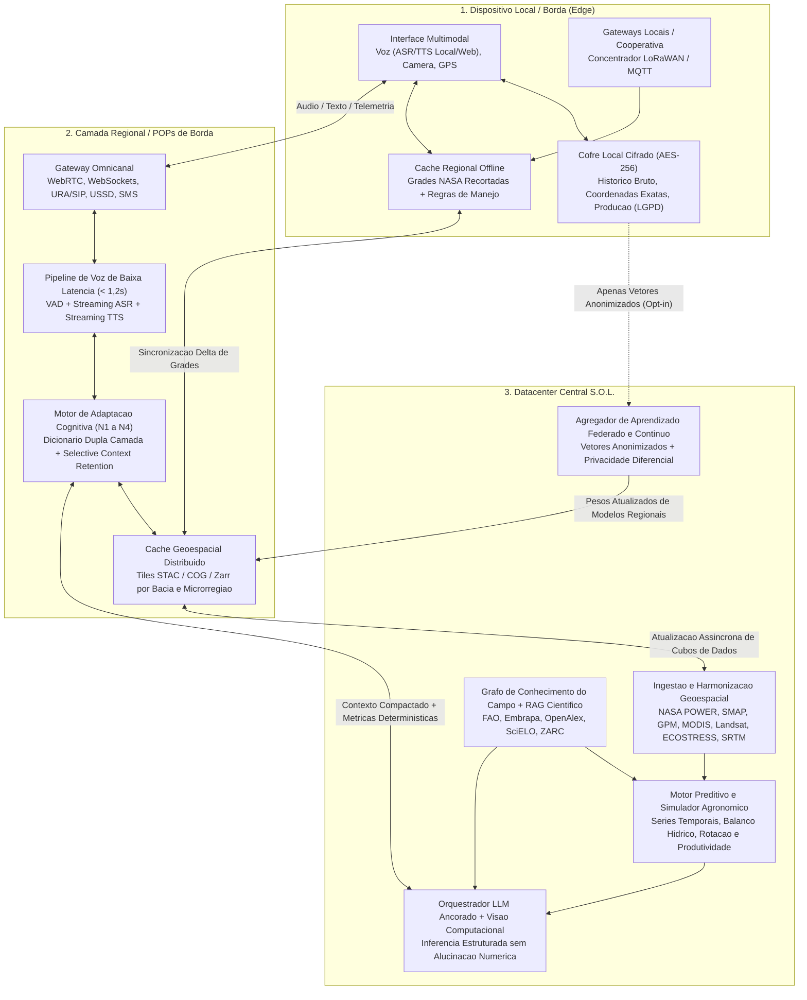
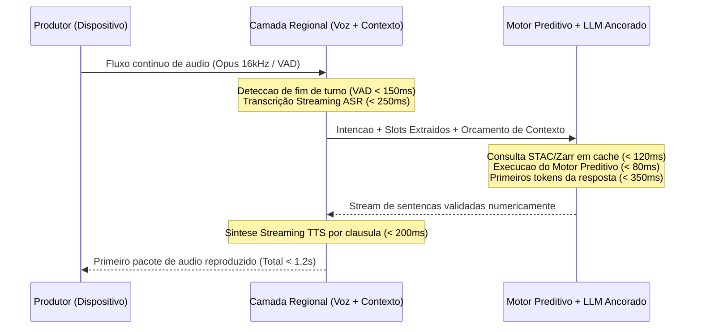

# Plano Diretor de Escalabilidade Técnica e de Produto — S.O.L. (Satellite-Oriented LLM)

**Organização:** B.I.G. Tech (Boundless Intelligence & Global Tech)  
**Instituição:** Departamento de Ciência da Computação, Universidade Estadual do Sudoeste da Bahia (UESB)  
**Evento:** NASA Space Apps Challenge 2026 — Field Shift: Adapting Farms with NASA Data  

---

## Sumário

1. [Visão Geral da Arquitetura de Escalabilidade](#1-visão-geral-da-arquitetura-de-escalabilidade)
2. [Pilar 1: Acessibilidade Adaptativa e Omnicanalidade](#2-pilar-1-acessibilidade-adaptativa-e-omnicanalidade)
3. [Pilar 2: Utilidade Profunda e Fusão de Dados Multimodal](#3-pilar-2-utilidade-profunda-e-fusão-de-dados-multimodal)
4. [Pilar 3: Eficiência, Engenharia de Contexto e Arquitetura Híbrida](#4-pilar-3-eficiência-engenharia-de-contexto-e-arquitetura-híbrida)
5. [Matriz de Atendimento por Perfil e Fases de Evolução](#5-matriz-de-atendimento-por-perfil-e-fases-de-evolução)

---

## 1. Visão Geral da Arquitetura de Escalabilidade

A transição do protótipo funcional do S.O.L. (`index.html`) para uma plataforma de escala nacional e continental exige uma arquitetura distribuída capaz de operar sob restrições severas de conectividade rural, mantendo rigor científico agronômico, proteção de dados e latência conversacional natural.

### 1.1 Princípios Arquiteturais Fundamentais

1. **Edge-First (Processamento Prioritário na Borda):** Dispositivos móveis e gateways rurais executam captura de voz, pré-processamento acústico, cache de grades agrometeorológicas da microrregião, inferência leve e armazenamento seguro local. O sistema permanece funcional mesmo durante interrupções de conectividade com a internet.
2. **Voz como Interface Universal (Voice-First UI):** Toda interação primária ocorre por fala natural em português e variantes regionais. A interface visual é complementar e acionada exclusivamente sob demanda, eliminando barreiras de letramento funcional e digital.
3. **LLM Ancorado (Grounded Generation — Proibição de Invenção Numérica):** O modelo de linguagem nunca estima nem inventa valores agronômicos, meteorológicos ou produtivos por conta própria. Todos os números verbalizados provêm estritamente de saídas determinísticas e auditáveis do Motor Preditivo (séries temporais, balanço hídrico, balanço de nitrogênio e estatísticas zonais da NASA) injetadas via esquema estruturado.
4. **Degradação Graciosa (Graceful Degradation):** A arquitetura se adapta automaticamente à qualidade de rede e ao hardware disponível:
   - **Conectividade plena (4G/5G/Fibra/Satélite):** Streaming bidirecional de áudio (WebRTC/WebSocket), síntese neural expressiva, visão computacional em tempo real e gráficos sob demanda.
   - **Conectividade intermitente (2G/EDGE/3G instável):** Sincronização assíncrona de pacotes compactados (Protobuf/CBOR), uso de modelos locais quantizados (ASR/TTS embarcados) e cache regional pré-carregado.
   - **Ausência de dados móveis (Rede GSM básica ou Rádio):** Atendimento via URA telefônica (voz sobre canal de telefonia convencional), menus USSD, mensagens SMS ou boletins automatizados para rádios comunitárias.

### 1.2 Diagrama de Fluxo entre Camadas (Dispositivo Local/Borda, Camada Regional e Datacenter Central S.O.L.)

---

## 2. Pilar 1: Acessibilidade Adaptativa e Omnicanalidade

Para que a inteligência orbital da NASA alcance desde o agricultor familiar em regiões semiáridas até engenheiros agrônomos de cooperativas e grandes grupos agrícolas, o S.O.L. desacopla o rigor do cálculo científico da forma como a informação é comunicada e entregue.

### 2.1 Camada de Adaptação Cognitiva e de Persona (Níveis N1 a N4)

O sistema classifica dinamicamente a interação em quatro níveis de complexidade cognitiva e técnica, ajustando vocabulário, ritmo de fala, estrutura frasal e densidade de indicadores:

| Nível | Persona Alvo | Características de Linguagem e Interação | Exemplo de Saída Verbalizada |
|---|---|---|---|
| **N1 — Oralidade Essencial** | Agricultor familiar com baixa ou nenhuma escolaridade formal; primeira interação digital | Frases curtas na voz ativa, analogias concretas do cotidiano rural, unidades locais ("tarefas", "sacas", "braças", "carroças"), zero jargão técnico, confirmação passo a passo | "Sua terra está com pouca água guardada. Se plantar feijão-caupi depois do milho e deixar a palha no chão, a terra segura o molhado da chuva e produz cerca de 28 sacas." |
| **N2 — Produtor Prático / Transição** | Pequeno e médio produtor habituado ao manejo comercial básico e feiras regionais | Vocabulário rural padronizado ("cobertura morta", "adubação verde", "quebra de ciclo de praga"), comparação direta de custo relativo e retorno em sacas ou toneladas por hectare | "A umidade do solo caiu nos últimos 30 dias. Recomendamos rotação com feijão-guandu para fixar nitrogênio no solo, reduzir gasto com adubo comprado e colher cerca de 3,6 toneladas." |
| **N3 — Técnico Agrícola / Extensionista / Cooperado** | Técnicos da ATER, agrônomos de cooperativas e produtores tecnificados | Terminologia agronômica precisa, citação de variáveis orbitais e desvios climatológicos, detalhamento de lâmina hídrica, cobertura do solo e janelas do ZARC | "O SMAP indica umidade volumétrica de 0,15 m³/m³ na zona radicular e anomalia de precipitação de -32% no GPM. O consórcio com crotalária reduz o risco hídrico em 45% e eleva o aporte de N." |
| **N4 — Gestão Corporativa / Ciência de Dados** | Engenheiros agrônomos seniores, gestores de fazendas comerciais, seguradoras e ERPs | Métricas quantitativas completas, intervalos de confiança, séries temporais multiespectrais, exportação via API/JSON/GeoJSON e relatórios auditáveis por talhão | "Talhão 04 (120 ha): NDVI médio 0,48 (MODIS/Landsat), estresse evaporativo ESI -1,4 (ECOSTRESS), declividade média 9% (SRTM). Cenário 2 maximiza relação benefício/custo com ETo ajustada." |

A transição entre os níveis pode ser:
- **Automática:** inferida a partir do vocabulário utilizado pelo usuário nos primeiros turnos de conversa (uso de termos como "tarefa" vs. "hectare", "terra fraca" vs. "déficit de macronutrientes").
- **Explícita:** solicitada por voz a qualquer momento ("fale mais simples", "explique no modo técnico").

### 2.2 Dicionário de Dupla Camada (Simples / Técnico)

O motor generativo consulta uma ontologia léxica bidirecional que mapeia expressões regionais brasileiras para conceitos agronômicos formais e vice-versa:

| Conceito Científico / Orbital | Camada Técnica (N3 / N4) | Camada Simples / Regional (N1 / N2) |
|---|---|---|
| Umidade volumétrica na zona radicular (`SMAP L3/L4`) | Fração de água disponível no solo ($m^3/m^3$) e capacidade de campo | "Água guardada na terra", "umidade onde a raiz bebe" |
| Índice de Vegetação por Diferença Normalizada (`MODIS` / `Landsat NDVI`) | Vigor fotossintético e biomassa verde do dossel | "Força e verde da planta", "saúde da folhagem" |
| Temperatura de Superfície e Evapotranspiração (`ECOSTRESS LST / ET`) | Déficit de pressão de vapor e estresse térmico foliar | "Sede da planta no calor", "dias de sol muito quente acima de 35 graus" |
| Fixação Biológica de Nitrogênio (FBN por leguminosas) | Aporte simbiótico de $N$ via *Rhizobium* em rotação | "Adubo de graça que o feijão deixa na terra" |
| Cobertura morta / Plantio direto na palha (`Landsat Bare Soil`) | Redução de albedo exposto, escoamento superficial e evaporação | "Deixar a palha cobrindo o chão para segurar o molhado" |
| Declividade e erodibilidade topográfica (`SRTM DEM`) | Gradiente altimétrico e susceptibilidade à erosão laminar | "Risco de a enxurrada levar a terra boa embora na ladeira" |
| Unidades de área agrária regional | Hectares ($ha$, $10.000\text{ m}^2$) | Tarefa baiana ($4.356\text{ m}^2$), alqueire ($24.200\text{ m}^2$), metros quadrados |

### 2.3 Omnicanalidade Offline-First

O S.O.L. opera em seis canais integrados sobre o mesmo núcleo de decisão:

1. **Aplicação Web Progressiva (PWA Offline-First):** Baseada na evolução do `index.html`, com Service Workers, armazenamento IndexedDB cifrado e WebAssembly para modelos compactos de voz quando offline.
2. **URA Telefônica (IVR / Voz sobre GSM 2G):** O produtor liga gratuitamente (0800 ou número local) de qualquer telefone simples (feature phone) sem internet; a chamada é atendida pelo pipeline de voz do S.O.L.
3. **USSD (`*xxx#`):** Menus interativos rápidos na tela de celulares básicos via sinalização de rede celular, permitindo consultar janela de chuva e recomendação por localização da antena (Cell-ID) ou município.
4. **SMS Bidirecional:** Alertas curtos de geada, veranico, estresse hídrico ou janela ideal de plantio em até 160 caracteres.
5. **Boletins Automatizados para Rádios Comunitárias:** Geração diária de áudios síntese de 60 a 90 segundos por microrregião para veiculação em emissoras rurais locais.
6. **API REST / GraphQL / Webhook:** Integração direta com sistemas de cooperativas, plataformas de Assistência Técnica e Extensão Rural (ATER), ERPs agrícolas e sistemas de crédito e seguro rural (Proagro/ZARC).

---

## 3. Pilar 2: Utilidade Profunda e Fusão de Dados Multimodal

Para substituir a simulação determinística do protótipo por inteligência agronômica em escala real, o S.O.L. estrutura sua base de decisão sobre um pipeline multimodal que funde observação da Terra, literatura científica validada, diagnóstico visual e sensores de campo.

### 3.1 Grafo de Conhecimento do Campo (Field Knowledge Graph)

No centro da camada de dados opera um Grafo de Conhecimento geocêntrico que relaciona entidades e restrições agronômicas:
- **Nós principais:** `Bioma`, `Microrregião`, `TipoDeSolo` (SiBCS/Embrapa), `Cultura`, `Cultivar`, `PragaDoença`, `PráticaDeManejo`, `JanelaZARC`, `IndicadorOrbital`.
- **Arestas semânticas:** `SUCEDE_EM_ROTACAO`, `FIXA_NUTRIENTE`, `QUEBRA_CICLO_DE`, `TOLERA_DEFICIT_HIDRICO`, `RECOMENDADO_PARA_SOLO`, `RESTRITO_POR_DECLIVIDADE`.
- Esse grafo impede que o sistema recomende consórcios ou rotações agronomicamente incompatíveis (como duas culturas hospedeiras do mesmo nematoide ou exigentes no mesmo perfil nutricional sem reposição).

### 3.2 Ingestão e Harmonização das Sete Fontes da NASA (Grade Comum STAC / COG / Zarr)

As sete fontes orbitais utilizadas pelo S.O.L. possuem resoluções espaciais e temporais nativas heterogêneas. O pipeline de ingestão realiza o recorte espacial (por polígono do talhão ou raio derivado da área informada: $r = \sqrt{\text{Área}/\pi}$) e harmoniza todas as camadas em cubos de dados geoespaciais padronizados:

| Fonte NASA | Resolução Nativa | Variáveis Extraídas | Papel na Harmonização e Fusão |
|---|---|---|---|
| **NASA POWER** | ~50 km / Diária | Radiação solar (insolação), $T_{\max}$, $T_{\min}$, umidade relativa, ETo | Série histórica de base para graus-dia acumulados e balanço climatológico |
| **SMAP** | 9 km a 36 km / 2–3 dias | Umidade superficial (0–5 cm) e zona radicular (0–100 cm) | Submetido a *downscaling* espacial usando MODIS/Landsat NDVI, ECOSTRESS e SRTM |
| **GPM (IMERG)** | ~10 km / 30 min a Diária | Precipitação acumulada (30d, 90d, safra), anomalias e dias de chuva extrema | Cálculo de desvio pluviométrico frente à normal climatológica e erosividade da chuva |
| **MODIS** | 250 m a 1 km / 8–16 dias | NDVI, EVI e fenologia regional | Monitoramento contínuo de vigor vegetativo em janelas nubladas |
| **Landsat (8/9)** | 30 m / 16 dias | Reflectância de superfície, NDVI de alta resolução e fração de solo exposto | Detecção de meses de solo descoberto no ano e delimitação intratalhão |
| **ECOSTRESS** | 70 m / Variável (ISS) | Temperatura da superfície terrestre (LST) e índice de estresse evaporativo (ESI) | Detecção precoce de estresse térmico e hídrico antes do amarelecimento foliar |
| **SRTM** | 30 m / Estático | Elevação digital (DEM), declividade (%), orientação de vertente e índice topográfico (TWI) | Ponderação de escoamento superficial, retenção hídrica em baixadas e risco de erosão |

**Padrões de Armazenamento Geoespacial:**
- **STAC (SpatioTemporal Asset Catalog):** Indexação padronizada de cenas e séries temporais para busca instantânea por *bounding box* e intervalo temporal.
- **COG (Cloud-Optimized GeoTIFF):** Leitura parcial via *HTTP Range Requests* apenas dos pixels correspondentes à propriedade do usuário, sem necessidade de baixar imagens inteiras.
- **Zarr:** Cubos multidimensionais (`latitude × longitude × tempo × variável`) pré-agregados para consultas de séries históricas em milissegundos.

### 3.3 RAG Científico (Retrieval-Augmented Generation Auditável)

Toda explicação agronômica e recomendação de manejo é fundamentada por recuperação vetorial e híbrida (BM25 + embeddings densos) sobre bases científicas curadas:
- **Embrapa (Empresa Brasileira de Pesquisa Agropecuária):** Comunicados técnicos, circulares de manejo por bioma (Caatinga, Cerrado, Mata Atlântica, Amazônia, Pampa, Pantanal), sistemas de plantio direto, consórcios e Zoneamento Agrícola de Risco Climático (ZARC).
- **FAO / ONU:** Manuais de agricultura conservacionista, coeficientes de cultura ($K_c$ — FAO 56) para evapotranspiração e guias de adaptação climática.
- **OpenAlex e SciELO:** Artigos revisados por pares sobre cultivares tolerantes à seca, controle biológico de pragas e manejo regenerativo de solos tropicais e semiáridos.

Cada trecho recuperado carrega metadados de fonte, ano, região de validade e cultura, garantindo rastreabilidade e evitando extrapolação indevida de práticas de clima temperado para solos tropicais.

### 3.4 Visão Computacional em Campo

Quando o dispositivo possui câmera e o produtor envia uma foto ou vídeo curto de uma folha, planta ou perfil de solo (via `FileReader` / `MediaStream`):
1. Um modelo leve embarcado (MobileNetV4 / EfficientNet quantizado) verifica qualidade de foco e iluminação na borda.
2. Na camada regional/central, modelos de visão-linguagem e classificadores fitossanitários identificam sintomas visuais de deficiências nutricionais (clorose nitrogenada, necrose marginal potássica), pragas (como *Spodoptera frugiperda* no milho) ou doenças fúngicas, além de estimar a porcentagem de cobertura de palhada no solo.
3. O diagnóstico visual é cruzado com os dados orbitais (por exemplo: diferenciar murcha fisiológica por déficit hídrico apontado pelo SMAP/ECOSTRESS de ataque radicular localizado).

### 3.5 Integração com Sensores IoT (LoRaWAN / MQTT)

Em propriedades ou assentamentos equipados com estações agrometeorológicas ou sensores de solo de baixo custo:
- Sensores de tensiometria/capacitância de solo, pluviômetros digitais e sensores de temperatura/umidade foliar transmitem pacotes via **LoRaWAN** (alcance de 5 a 15 km no campo sem necessidade de chip celular em cada ponto) até um gateway na sede ou cooperativa.
- O gateway publica as leituras via protocolo **MQTT** com TLS para a camada regional do S.O.L.
- Os dados *in situ* calibram localmente (assimilação de dados por filtro de Kalman / correção de viés) as estimativas orbitais do SMAP, GPM e NASA POWER, aumentando a precisão em escala de sub-hectare.

---

## 4. Pilar 3: Eficiência, Engenharia de Contexto e Arquitetura Híbrida

### 4.1 Streaming de Voz de Baixa Latência (< 1,2 s Time-To-First-Audio)

Para manter a fluidez de uma conversa humana, o tempo entre o fim da fala do produtor e o início da resposta audível do S.O.L. deve ser inferior a **1,2 segundo**:

### 4.2 Selective Context Retention (Retenção Seletiva de Contexto por Orçamento de Tokens)

Conversas longas em modelos de linguagem degradam a latência, elevam o custo computacional e aumentam o risco de perda de foco ("lost in the middle"). O S.O.L. implementa **Selective Context Retention** com orçamento rígido de tokens dividido em quatro blocos:

1. **Estado Estruturado Canônico (~150 tokens — Imutável por turno):** JSON enxuto contendo coordenadas arredondadas para grade, área normalizada em hectares, unidade preferida do produtor, cultura atual, dificuldade principal (`pain`), nível de persona (`N1`–`N4`) e índices calculados pelo motor preditivo (`ws`, `sd`, `prod`).
2. **Fatos Agronômicos Destilados (~250 tokens):** Resumo cumulativo apenas das informações permanentes reveladas pelo produtor ao longo do histórico (ex.: "possui cisterna de enxurrada", "não usa trator", "plantou mandioca na safra passada"), descartando saudações, hesitações, repetições e ruídos de transcrição.
3. **Evidência RAG e Orbital do Turno (~400 tokens):** Apenas os indicadores numéricos do `pipe()`/`build()` real e os fragmentos científicos estritamente relevantes para a pergunta ativa.
4. **Janela Deslizante Curta (~200 tokens):** Apenas os últimos 2 turnos literais para manter coesão dialógica imediata.

Com isso, toda chamada ao LLM opera dentro de um orçamento máximo de **~1.000 tokens de entrada**, garantindo custo previsível em centavos de dólar por safra/usuário e latência constante independentemente da duração da sessão.

### 4.3 Aprendizado Contínuo e Federado em Datacenter

O S.O.L. evolui a cada safra sem centralizar dados privados dos agricultores:
- **Aprendizado Federado (Federated Learning):** Modelos locais e regionais de calibração de produtividade e reconhecimento acústico de sotaques calculam gradientes localmente.
- **Privacidade Diferencial ($\epsilon$-Differential Privacy):** Antes de qualquer envio ao Datacenter Central, os vetores de atualização recebem ruído laplaciano/gaussiano calibrado e têm identificadores pessoais e coordenadas exatas removidos (geohash agregador em nível de microrregião ou bacia hidrográfica, mínimo de $k$-anonimato $k \ge 50$ propriedades).
- **Ciclo de Retreino por Safra:** Ao final de cada ciclo agrícola, a comparação entre produtividade estimada e produtividade reportada recalibra os pesos regionais dos modelos preditivos.

### 4.4 Cofre Local Cifrado (AES-256) e Conformidade Integral com a LGPD

Em conformidade com a Lei Geral de Proteção de Dados Pessoais (Lei nº 13.709/2018) e princípios de soberania de dados rurais:
- **Criptografia Local em Repouso:** Coordenadas GPS de alta precisão, histórico de áudio, fotos da propriedade e volumes financeiros ou de colheita são armazenados exclusivamente no **Cofre Local Cifrado** do dispositivo (`IndexedDB` / `SQLite` cifrado com **AES-256-GCM** via Web Crypto API / chave derivada do dispositivo).
- **Minimização na Consulta Orbital:** Para buscar dados da NASA na camada regional, o dispositivo não envia a coordenada exata do domicílio rural, mas sim o identificador do bloco de grade (Tile ID / Geohash de resolução intermediária) e realiza o recorte fino localmente.
- **Consentimento por Voz Auditável e Revogação Simples:** O produtor pode ordenar por voz `"apagar meus dados"` ou `"esquecer minha terra"`, acionando a destruição imediata das chaves criptográficas locais.

---

## 5. Matriz de Atendimento por Perfil e Fases de Evolução

### 5.1 Matriz de Atendimento por Perfil de Usuário

| Dimensão | Pequeno Produtor / Agricultura Familiar | Médio Produtor Cooperado / ATER | Grande Empresa Agrícola / Agroindústria |
|---|---|---|---|
| **Área Típica** | 0,5 a 20 hectares (ou medição em tarefas/metros) | 20 a 500 hectares | Acima de 500 hectares (múltiplos talhões e fazendas) |
| **Nível de Persona Padrão** | N1 (Oralidade Essencial) ou N2 (Prático) | N2 (Prático) ou N3 (Técnico / Extensionista) | N3 (Técnico) e N4 (Gestão Corporativa / Ciência de Dados) |
| **Canais Principais** | Web App Voice-First (PWA), URA 0800, USSD, SMS e Rádio Comunitária | PWA Offline-First, Painel da Cooperativa e Modo Multi-Propriedade para Técnicos | API REST/GraphQL, Integração ERP, Dashboard Geoespacial por Talhão e Relatórios ESG |
| **Sensores e Dados de Entrada** | Voz + GPS do celular + Satélites NASA + Fotos simples da lavoura | Voz + Polígonos CAR/SIGEF + Satélites NASA + Laudos de solo + Estação da cooperativa | Satélites NASA + Malha densa IoT (LoRaWAN/MQTT) + Maquinário conectado + VANTs |
| **Foco da Recomendação** | Segurança hídrica e alimentar, redução de custo com insumos externos (adubação verde e rotação), quebra de pragas | Estabilidade produtiva, conformidade com ZARC/Proagro, otimização de insumos e comercialização via cooperativa | Eficiência operacional em larga escala, balanço de carbono, rastreabilidade socioambiental e mitigação de risco climático |
| **Modelo de Sustentabilidade Financeira** | **100% Gratuito** (subsidiado por políticas públicas, programas de ATER e licenciamento corporativo) | Assinatura coletiva via Cooperativa, Sindicato ou Associação | Licenciamento SaaS/API por hectare monitorado e SLA dedicado |

### 5.2 Fases de Evolução (0–6 meses, 6–18 meses, 18–48 meses)

#### Fase 1: Consolidação do MVP e Validação em Campo (0 a 6 meses)
- **Engenharia e Dados:** Substituição do simulador determinístico (`pipe()`) por conectores reais em produção com **NASA POWER**, **GPM (IMERG)** e **SMAP**, utilizando catálogo STAC e recorte automatizado via FastAPI (Python).
- **Voz e RAG:** Implantação do pipeline de voz com suporte a sotaques regionais brasileiros (meta de Word Error Rate < 10% em termos rurais) e indexação inicial do RAG Científico com publicações da Embrapa e FAO para as culturas de milho, feijão, mandioca e hortaliças.
- **Privacidade e Canais:** Implementação do Cofre Local Cifrado AES-256 no PWA e lançamento do canal piloto via URA telefônica e SMS.
- **Critério de Sucesso:** Validação assistida com 50 a 100 agricultores familiares e técnicos agrícolas no Sudoeste da Bahia (região de Vitória da Conquista / UESB).

#### Fase 2: Expansão Regional, Multimodalidade e Cooperativas (6 a 18 meses)
- **Engenharia e Dados:** Integração completa das 7 fontes orbitais da NASA (incluindo **MODIS**, **Landsat 8/9**, **ECOSTRESS** e **SRTM**) harmonizadas em cubos Zarr/COG com *downscaling* espacial de umidade do solo.
- **Multimodalidade:** Ativação do módulo de Visão Computacional para diagnóstico de pragas, doenças e cobertura de palhada por foto/vídeo, além de importação de laudos laboratoriais de solo.
- **IoT e Ecossistema:** Primeiros pilotos com gateways LoRaWAN/MQTT em cooperativas parceiras e lançamento do modo multi-propriedade para agentes de extensão rural (ATER).
- **Critério de Sucesso:** 2.000 a 10.000 propriedades atendidas em múltiplos biomas (Caatinga, Cerrado e Mata Atlântica), com redução mensurável de perdas por janela de plantio inadequada.

#### Fase 3: Escala Nacional/Continental, Aprendizado Federado e API Corporativa (18 a 48 meses)
- **Engenharia e Inteligência:** Operação completa da arquitetura híbrida em 3 camadas com POPs regionais, **Aprendizado Federado** entre safras com privacidade diferencial e latência média global de voz abaixo de 1,0 segundo.
- **Cobertura Agronômica:** Expansão do Grafo de Conhecimento do Campo para mais de 40 culturas (incluindo café, cacau, soja, arroz, algodão, fruticultura e sistemas agroflorestais) e suporte multilíngue (Português, Espanhol, Inglês e línguas locais na América Latina e África Subsaariana).
- **Integração Institucional:** Abertura da API N4 para ERPs agrícolas, cooperativas de crédito, programas governamentais de compras públicas (PAA/PNAE) e seguro rural parametrizado por satélite.
- **Critério de Sucesso:** Operação autossustentável em centenas de milhares de propriedades, comprovando impacto direto nos Objetivos de Desenvolvimento Sustentável da ONU (ODS 2, ODS 6, ODS 13 e ODS 15).
